# 拾景

拾景从 NAS 上的图片库里挑出分辨率和方向合格的横屏图片，每次随机选一批复制到壁纸文件夹，配合 macOS「系统设置 › 墙纸」的文件夹随机切换使用。

macOS 原生应用，使用 Go 和 [MyGo](https://mygo.egoist.dev/) 开发，界面跟随系统的浅色 / 深色外观。

<picture>
  <source media="(prefers-color-scheme: dark)" srcset="docs/screenshots/overview-dark.png">
  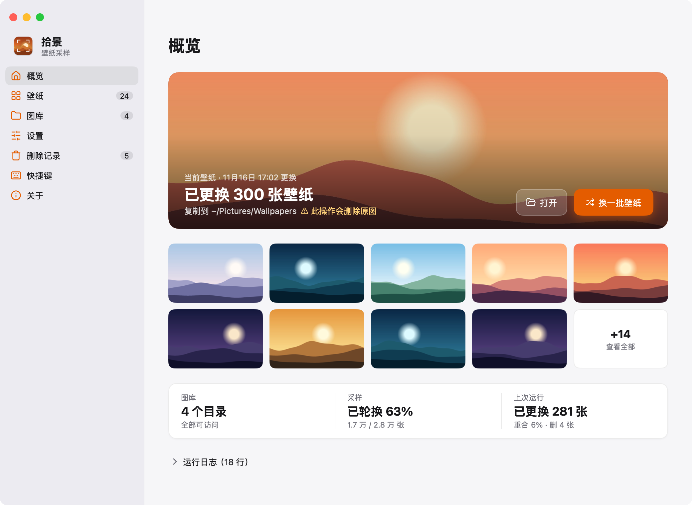
</picture>

## 安装

在 [Releases](../../releases) 下载最新版，拖进「应用程序」。每个版本有两个安装包：`shi-jing-<版本>.dmg` 是通用版，适用于 Intel 和 Apple Silicon；`shi-jing-<版本>-arm64.dmg` 只适用于 Apple Silicon，体积约为通用版的一半。

应用没有经过苹果公证。第一次打开时右键点应用选「打开」，或在「系统设置 › 隐私与安全性」里允许。

然后在「系统设置 › 墙纸」里把壁纸设为拾景的壁纸文件夹（默认 `~/Pictures/Wallpapers0`），打开随机切换。

## 用法

1. **图库**：添加图片所在的目录（通常在 NAS 上）。目录分两类，都参与采样：
   - **筛选 + 采样**：先删除竖屏、正方形和分辨率不足的原图，再参与采样
   - **仅采样**：采样时跳过不合格的图片，目录里的文件保持原样，适合收藏夹这类目录
2. **设置**：选择壁纸文件夹、每次张数、最低分辨率（4K / 5K / 2K / 1080p / 自定义）。改动自动保存。
3. **概览**：点「换一批壁纸」（⌘R），依次执行筛选 → 采样 → 复制 → 刷新系统壁纸，系统的文件夹轮换随即使用新的一批。单击顶部横幅进入幻灯片模式（先铺满当前窗口，可按 `F` 切换系统全屏），配液态玻璃时钟与文件名卡片、自动隐藏控制条和防息屏，点文件名卡片或「整理」可直接跳到当前图的大图预览。缩略图按窗口大小排满，下次换一批之前顺序保持固定。单击缩略图打开大图预览，预览尺寸跟随窗口，可以全屏；用 ←→ 或鼠标滚轮翻看这一批的全部壁纸。
4. **整理**：大图预览和右键菜单里有三个操作：「移出壁纸文件夹」「移出并不再选它」只处理壁纸文件夹里的那份，图库里的原图保留；「删除图库里的原图」不可撤销，图库未连接时进入队列，连接后执行。来自「仅采样」目录的图片不允许删除原图。预览的键盘操作：

   | 按键 | 操作 |
   |---|---|
   | 空格 / ⇧空格、← → | 下一张 / 上一张 |
   | J | 移出 |
   | K | 移出并不再选 |
   | L | 删除原图（回车确认） |
   | ⌘Z | 撤销移出（J、K 和右键菜单的移出都可以撤销，删除原图不可撤销） |
   | 数字 + 回车 | 跳到这个编号 |
   | O | 用默认应用打开 |
   | D / F | 在 Finder 中选中这张壁纸 / 它的原图 |
   | Esc | 关闭预览 |

   按钮上标着对应的快捷键，可以在「快捷键」页修改。
5. **壁纸**：点缩略图最后一格「+N」打开这一页，显示壁纸文件夹里的全部图片，可以按文件名搜索、按原图目录筛选（和手机上的「全部壁纸」相同）。单击打开大图，右键菜单里是同一组整理操作。点「选择」进入多选，可以一次移出或不再选多张；删除原图需要一张一张操作。

<table>
  <tr>
    <td>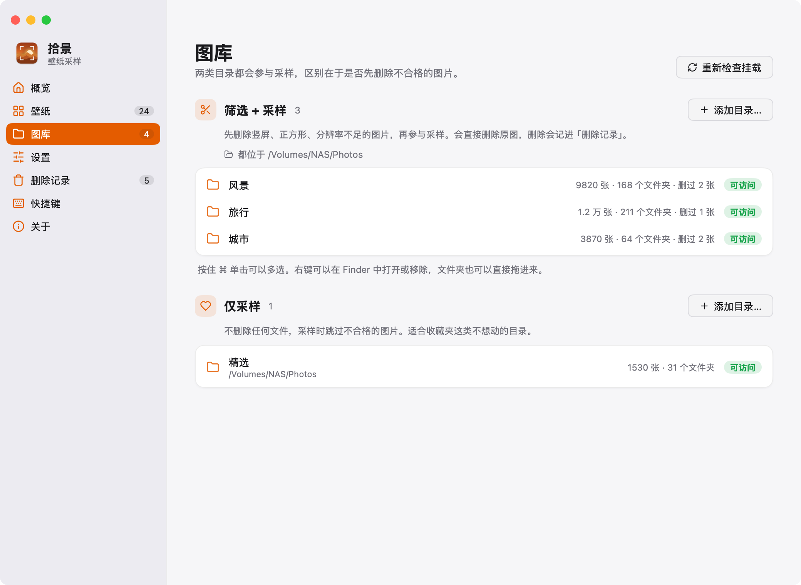</td>
    <td>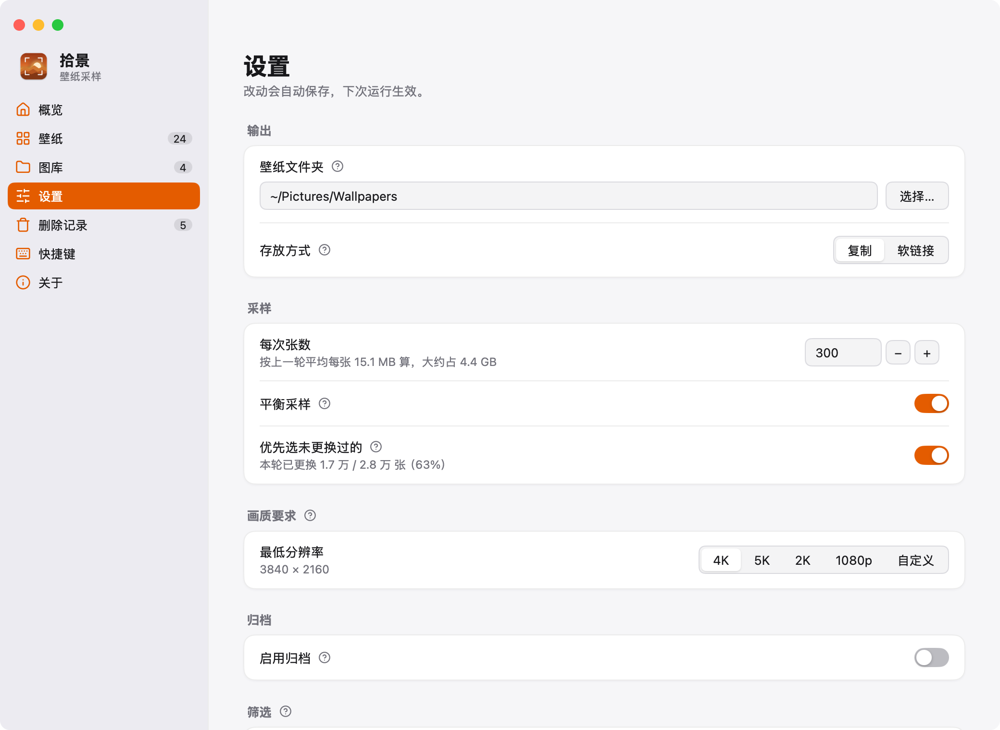</td>
  </tr>
  <tr>
    <td align="center">图库：两类源目录和挂载状态</td>
    <td align="center">设置：改动自动保存</td>
  </tr>
  <tr>
    <td>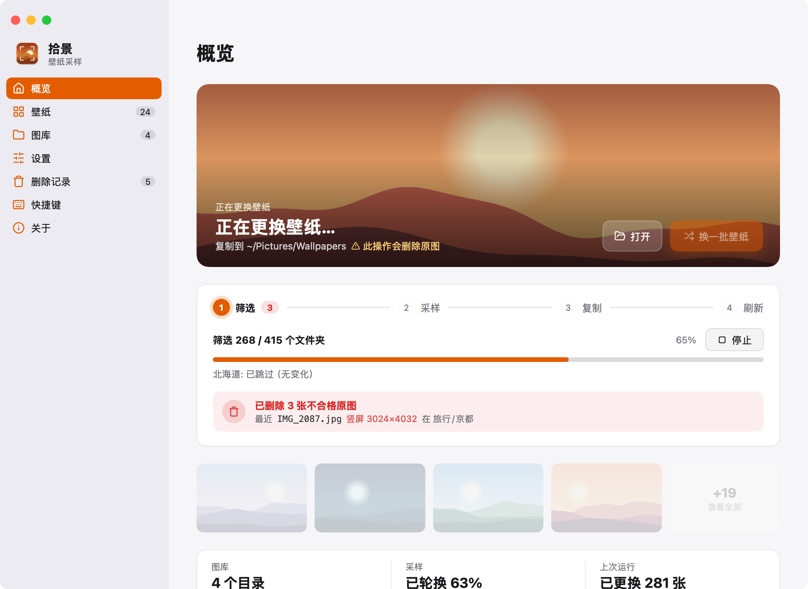</td>
    <td>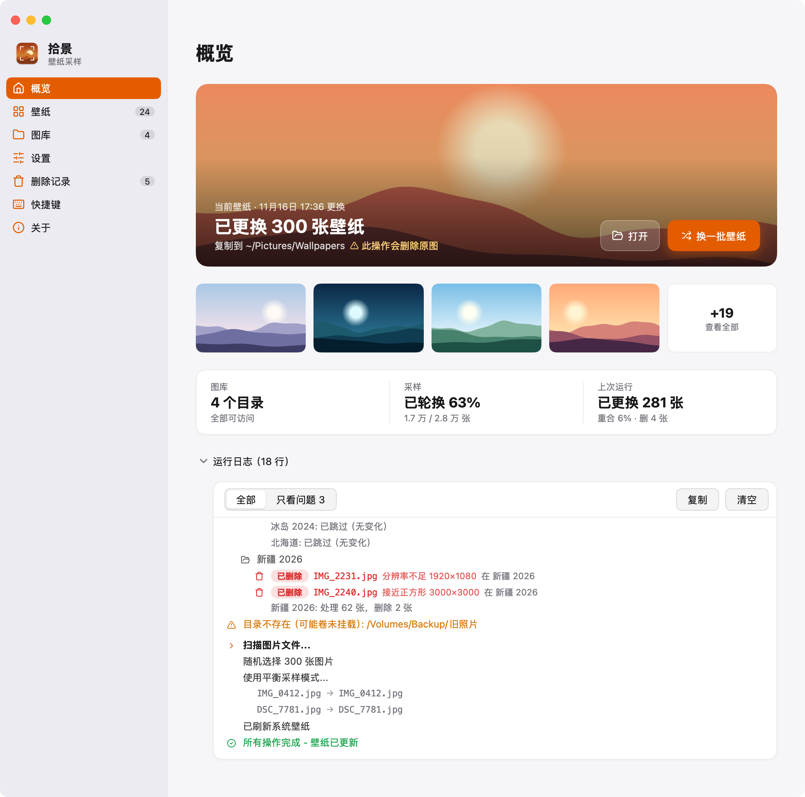</td>
  </tr>
  <tr>
    <td align="center">运行中：步骤、进度、删除情况，可以随时停止</td>
    <td align="center">运行日志：按类型排版，可以只显示问题</td>
  </tr>
  <tr>
    <td>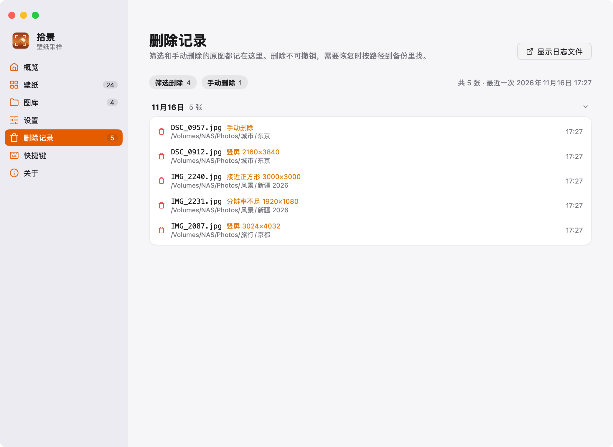</td>
    <td>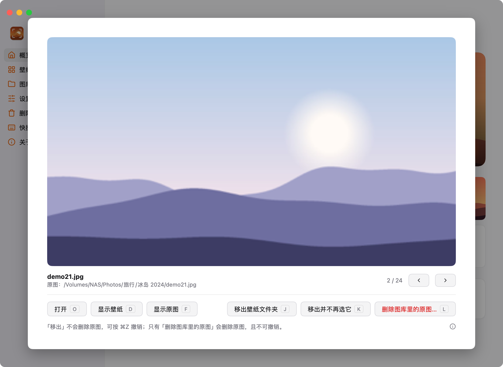</td>
  </tr>
  <tr>
    <td align="center">删除记录：文件名、路径、删除原因</td>
    <td align="center">大图预览：按钮上标着快捷键</td>
  </tr>
  <tr>
    <td>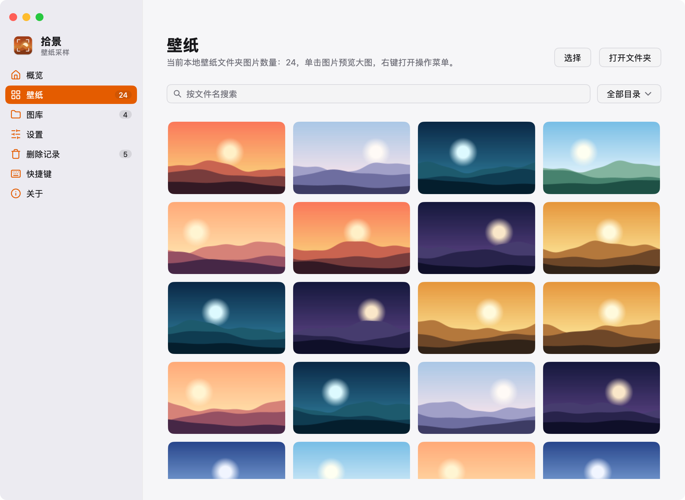</td>
    <td>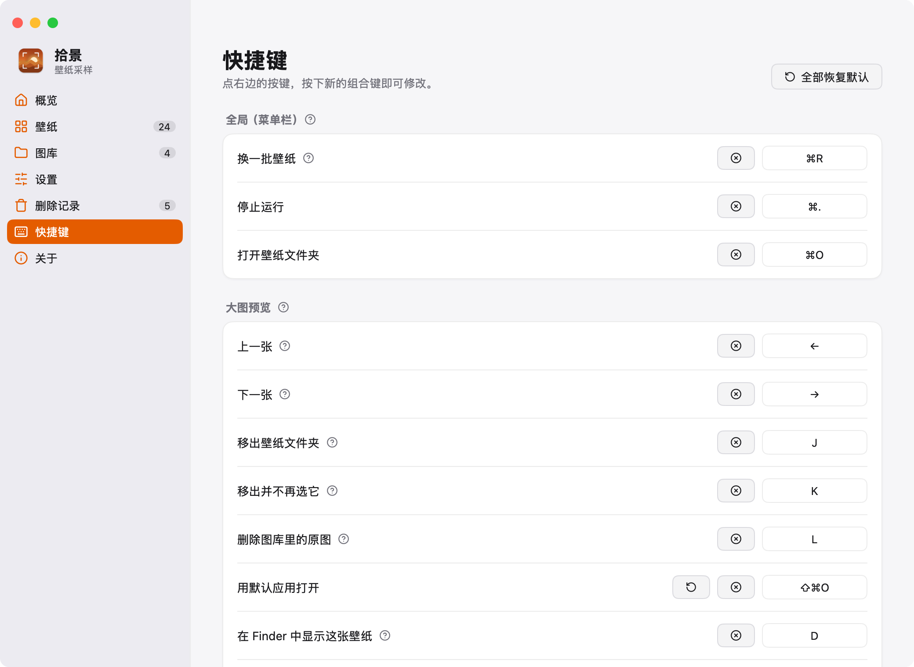</td>
  </tr>
  <tr>
    <td align="center">壁纸：按文件名搜索、按原图目录筛选、多选移出</td>
    <td align="center">快捷键：点一下，再按新的组合键</td>
  </tr>
</table>

> [!WARNING]
> 「筛选 + 采样」目录里不合格的图片会被**直接删除**（NAS 上的原图，不可撤销）。第一次使用或改了分辨率时，建议先在设置里关闭「删除不合格原图」模拟运行一次，看日志里「待删除」的图片是否符合预期。打开删除时，点「换一批壁纸」会先弹窗确认；每个被删除的文件都记在「删除记录」页里，包括删除原因。

## 功能

- **增量筛选**：只检查有变化的文件夹。判断是否变化时忽略 `._*`、`.DS_Store`、`@eaDir` 等 macOS 和 NAS 生成的文件；改了分辨率后全部重新检查。
- **平衡采样**：每个子文件夹优先选一张，子文件夹的顺序每次随机打乱。
- **优先选未更换过的**：记录这一轮轮换里已经换上过的图，下次先从其余的图里选，整个图库换完一遍后开始新一轮。概览页显示轮换进度（如「已轮换 63%」）、这次新换了几张和与上一轮的重合率。
- **删除情况**：运行中实时显示删了几张、最近删除的是哪张。「删除记录」页按日期列出每张被删原图的路径和原因（竖屏 / 接近正方形 / 分辨率不足 / 手动删除）；点日期标题可以收起这一天；顶部两个标签分别筛选「筛选删除」和「手动删除」，可以同时选。
- **图库统计**：每个目录显示可用图片数、文件夹数和删除过的张数；设置页按上一轮的平均文件大小估算每批占用的空间；复制时显示剩余时间。
- **在缩略图上整理**：移出图片、加入「不再选」名单（可在图库页恢复），或删除原图（需要确认，记入删除记录）。
- **图库未连接时整理**：NAS 未连接时，看图、移出、撤销、不再选照常可用。「删除原图」进入队列：壁纸文件夹里的那份先移出（⌘Z 可撤销），概览页显示「N 项原图等待删除」，可以逐条取消；图库连接后，校验文件没有被改动过再删除，并记入删除记录。
- **自动换壁纸**（可选）：每 6 小时、12 小时、每天或每周自动换一批。自动运行只模拟筛选，原图保留。
- **NAS 读写并发**：读目录、读图片尺寸和复制都并发执行；图库没有改动时，一轮筛选需要十几秒。
- **壁纸文件夹的保护**：确认选出了图片后才清空壁纸文件夹，NAS 未挂载时壁纸文件夹保持原样；目录未挂载时界面会提示，全部未挂载时「换一批壁纸」按钮不可用。桌面版和命令行同一时间只有一个能运行。
- **刷新系统壁纸**：换完后重启 macOS 的壁纸服务（`WallpaperAgent`）。系统的文件夹轮换只在启动时读取一次文件夹内容，刷新后才会使用新的一批。
- **拖放添加**：把文件夹拖到图库页对应的区域即可添加。
- **后台运行**：关闭窗口（⌘W 或红色按钮）后应用继续运行，Dock 图标隐藏，图标留在菜单栏。点菜单栏图标可以打开主界面、查看状态（图库是否连接、当前配置方案、上次换了几张、当前进行到哪一步）、切换配置方案并换一批、换一批 / 停止、打开壁纸文件夹、退出。窗口隐藏时任务完成会发通知。⌘Q 或菜单栏里的「退出拾景」退出应用。
- **配置方案**：在设置页把不同的图库组合、每次张数、最低分辨率和采样选项存成多套方案（如日常风景、暗色极简），在设置页、菜单栏或 iPhone 上一键切换或直接切换并换一批。
- **手机遥控**（可选，iOS）：在设置里打开「允许手机遥控」后，同一局域网里的 iPhone 可以用拾景 App 配对，查看实时进度、切换配置方案、换一批壁纸、停止运行，浏览当前壁纸的缩略图和大图，移出 / 不再选 / 删除原图 / 撤销移出 / 分享原图，修改常用设置，管理待删除原图队列与「不再选」名单，查看日志和删除记录；还有主屏幕小组件和快捷指令。会删除原图时手机上先确认，也可以选择这次只模拟。详见下文。
- **硬链接归档**（可选）：在 NAS 上为这批图片另外保留一份硬链接副本，详见下文。
- **复制或软链接**：软链接节省空间，NAS 未挂载时壁纸无法显示。

快捷键：⌘R 换一批壁纸、⌘. 停止、⌘O 打开壁纸文件夹、⌘1–5 切换页面、⌘, 设置。换一批、停止、打开壁纸文件夹和预览里的全部操作都可以在侧边栏的「快捷键」页修改：点一下再按新的组合键，冲突时会提示，改动保存在配置的 `shortcuts` 里。

## 手机遥控（iOS）

iOS 端是原生 SwiftUI 应用，用来遥控 Mac：筛选和复制都在 Mac 上执行。窄屏显示一栏；宽屏（横屏、iPhone Duo 展开的内屏、iPad）上方是状态卡，下面分左右两栏，按实际宽度切换。

<table>
  <tr>
    <td>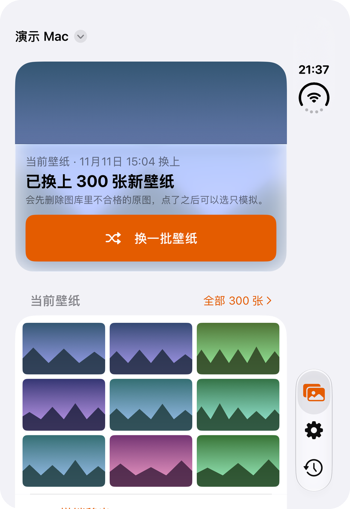</td>
    <td>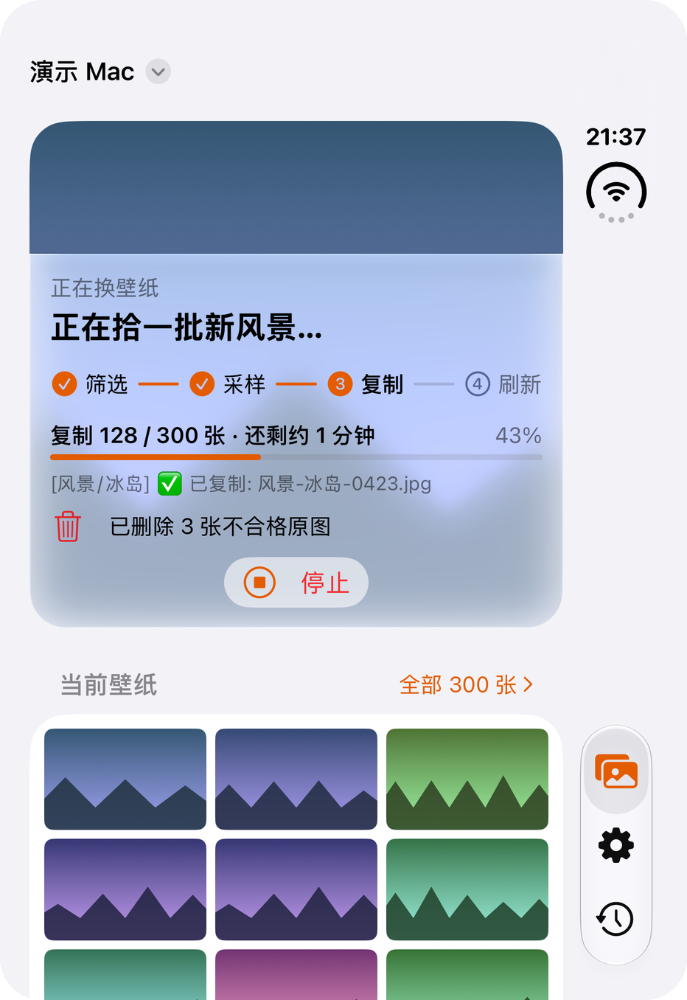</td>
    <td>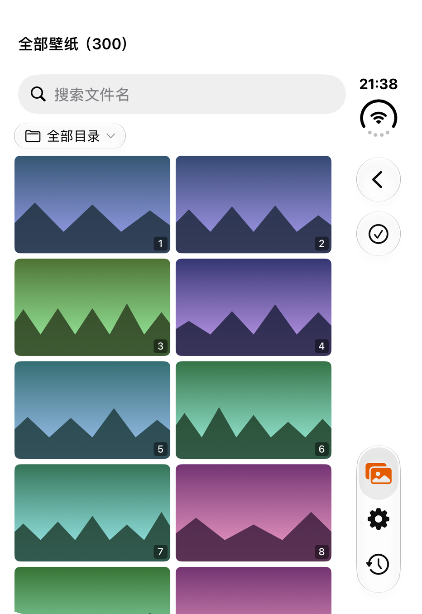</td>
  </tr>
  <tr>
    <td align="center">概览：状态、换一批 / 停止、当前壁纸</td>
    <td align="center">运行中：步骤和进度实时更新</td>
    <td align="center">全部壁纸：搜索、按原图目录筛选</td>
  </tr>
  <tr>
    <td>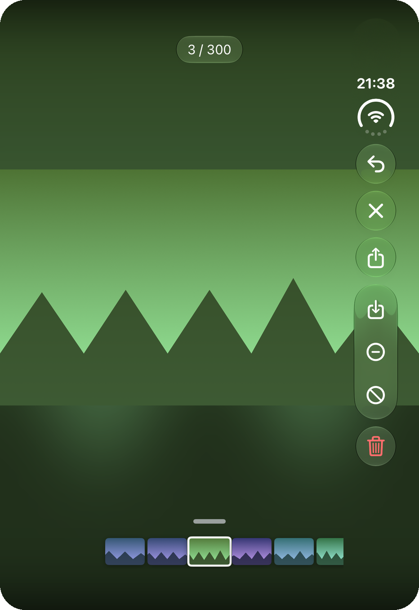</td>
    <td>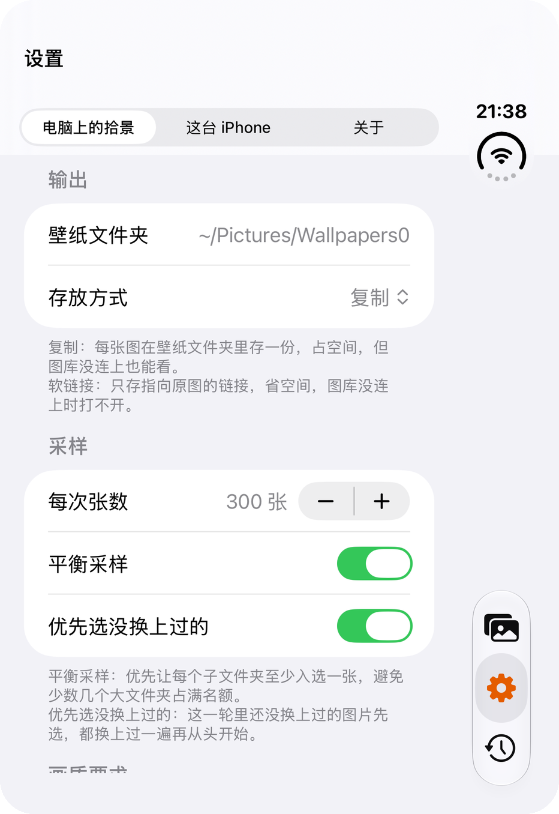</td>
    <td>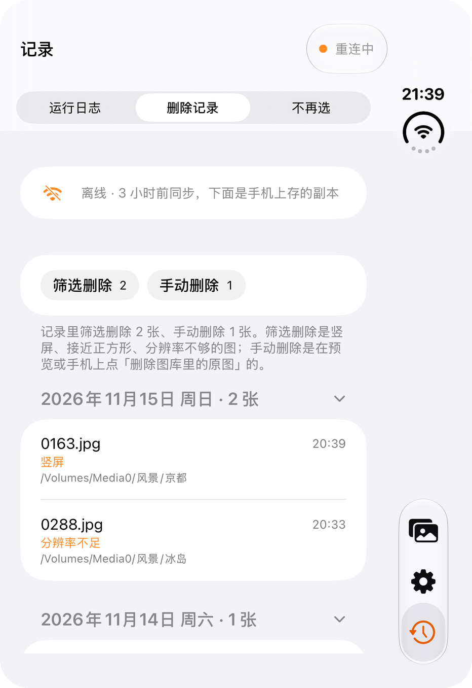</td>
  </tr>
  <tr>
    <td align="center">大图预览：翻页、分享、整理</td>
    <td align="center">设置：分组和电脑上相同，修改后立即生效</td>
    <td align="center">删除记录：按天分组、按类型筛选</td>
  </tr>
</table>

截图里的壁纸是演示用的示意图。

界面分三个标签：概览、设置、记录，对应电脑上的侧边栏。

- **概览**：顶部横幅卡的背景是当前壁纸里的一张（和电脑上概览顶部是同一张，单击打开大图），上面的毛玻璃面板显示当前状态、换一批 / 停止按钮、运行步骤和进度。保存了配置方案时可以直接在概览页一键切换或切换并换一批；有排队的待删除原图时显示入口，点击查看明细并逐条或全部取消。下面是「上一轮对比」（新换上的张数、重合率、筛选删除的张数、覆盖的文件夹数）。连接断开、正在重连或配对失效时，右上角显示连接状态。
- **当前壁纸**：缩略图网格，单击打开大图预览：
  - 左右滑动翻页，最后一张之后回到第一张；双指缩放；双击在「铺满 / 完整显示」之间切换（横屏默认铺满，竖屏默认完整显示）。
  - 上滑显示文件名，文件名显示时再上滑进入全屏（隐藏顶栏和缩略图条）；全屏时下滑回到常态；文件名显示时下滑收起文件名；常态下下滑关闭预览。
  - 底部的缩略图条可以拖动快速找图；点顶部编号输入数字跳转。
  - 存到相册、移出、不再选、删除原图四个按钮固定在底栏，位置和系统相册一致：竖屏在底部一排，宽屏在顶部一排，横放时在右侧一列。
  - 单击图片隐藏或显示顶栏和底栏。关闭预览时记住文件名是否显示，下次打开沿用。
- **整理**：预览底栏或长按缩略图可以「移出」（删除壁纸文件夹里那份，可以在电脑上用 ⌘Z 撤销）、「不再选它」、「删除图库里的原图」（需要二次确认，不可撤销，记入删除记录；来自「仅采样」目录的图片禁用此操作）。电脑正在换壁纸时，整理操作不可用。
- **撤销移出**：概览「当前壁纸」里和预览顶栏的 ↶ 按钮，和电脑上的 ⌘Z 使用同一个撤销记录。
- **存原图 / 分享原图**：「存到相册」从电脑下载原文件，原样存进相册，保留 EXIF；预览顶栏的分享按钮下载原文件后打开系统分享面板。
- **离线使用**：每次连接时，手机会保存当前壁纸列表、状态、缩略图和整批预览图（默认上限 10 GB，可在「设置 › 离线」里修改、暂停或清除）。换一批后，不在新一批里的图会被删除，在新一批里的图继续使用已有的缓存。打开「保存原图」后，图库里的原文件也会保存到手机，离线时可以存到相册或分享。
  - Mac 睡眠、拾景没有打开或不在同一个网络时，App 显示上次同步的内容，顶部标注「离线 · X 前同步」。
  - 离线时点「移出」「不再选」会记录下来，连接电脑后处理（「不再选」按原图路径处理，这一批已经换掉也有效）；离线时点「删除原图」也会记录下来，连接后需要在「设置 › 待处理操作」里逐张确认才会删除。「待处理操作」页列出所有记录的操作，可以逐条或全部取消；离线时也可以撤销刚才的「移出」，那张图回到列表原来的位置。
  - 运行日志、删除记录和「不再选」名单在每次连接和每换完一批时各保存一份，离线时显示这一份并标明同步时间；离线时「不再选」名单只能查看，连接后才能恢复。设置页离线时只能查看。
- **设置**：分组和电脑上的设置页相同，可以切换配置方案，修改每次张数、自动换的间隔、优先选未更换过的、换完刷新系统壁纸、删除不合格原图等，修改后电脑上同步生效并自动保存。「设置 › 关于」显示两端的版本号和签名到期时间。
- **记录**：顶部三个标签切换，也可以左右滑动切换：
  - 运行日志：运行中自动刷新。
  - 删除记录：按天分组，点日期标题收起这一天；顶部两个标签筛选「筛选删除」和「手动删除」，可以同时选；显示全部记录。有排队的待删除原图时顶部显示入口，点击进入「待删除原图」页逐条或全部取消。
  - 「不再选」的图片：点右侧「恢复」、左滑或长按恢复一张，列表末尾可以全部恢复。
- **小组件**有两种：
  - 「拾景」：背景是当前壁纸里的一张，上面是状态和「换一批」/「停止」按钮，从小组件换一批时不删除原图。尺寸：主屏幕的小 / 中 / 大 / 超大、iOS 27 的 iPhone 整页，以及锁定屏幕的三种。
  - 「拾景壁纸」：只显示壁纸，可以在角落显示文件名。尺寸：主屏幕的小 / 中 / 大 / 超大和 iOS 27 的 iPhone 整页。
  - 长按小组件 →「编辑小组件」可以修改换图间隔（1 分钟到 1 天）。单击小组件打开那张图的大图。
  - 小组件在手机上保存一份缩小的图，数量和这一批壁纸相同，轮换时使用这份缓存，1 分钟一换也只读本地文件；在线时在后台补齐。
  - 连接不到 Mac 时，小组件使用上次缓存的状态和图片继续轮换，并标注「离线」；回到局域网后恢复。
- **控制中心 / 锁定屏幕按钮**：「换一批壁纸」（iOS 18+）。
- **快捷指令 / Siri / 操作按钮**：「换一批壁纸」「停止换壁纸」「壁纸状态」，可以在后台执行，例如对 Siri 说「用拾景换一批壁纸」。
- **完成通知**：App 在后台仍保持连接时，或小组件刷新时发现这次已经换完，会发一条本地通知。没有推送，所以通知不一定每次都有。
- **签名到期提醒**：免费签名 7 天过期，剩余不到 2 天时概览顶部提醒，到期前一天发通知。
- **多台 Mac**：点顶部的 Mac 名字切换，添加、移除也在这个菜单里。小组件和快捷指令使用 App 里选中的那台。

配对步骤：

1. Mac 上打开拾景的「设置 › 手机遥控 › 允许手机遥控」。拾景监听端口 52819（被占用时使用其他端口），并通过 Bonjour 广播。
2. iPhone 上打开拾景 App，第一次会询问是否允许访问本地网络，选允许。首页列出这台 Mac，点它请求配对，Mac 上会弹出 6 位配对码，在手机上输入。也可以在 Mac 上点「设置 › 手机遥控 › 扫码配对」，用手机扫描二维码。
3. 之后打开 App 就能看到这台 Mac 的状态。Mac 的设置页列出配对过的设备和在线状态，可以取消配对或重命名。iOS 16 起系统只向 App 提供「iPhone」「iPad」这样的通用设备名，所以配对时默认填通用名；可以在手机上改成自己的名字（下次配对沿用）。

使用时 Mac 要处于唤醒状态、拾景要在运行（窗口关闭后在后台运行即可）。Mac 睡眠时手机无法连接，可以在「系统设置 › 电池 / 能源」里打开「唤醒以供网络访问」。Mac 的局域网 IP 变化后，App、小组件和快捷指令会通过 Bonjour 自动发现新地址并更新连接，无需重新配对。

局域网内使用 HTTP 明文通信，通过配对令牌鉴权（Mac 上只保存令牌的 SHA-256）。App 没有上架，需要用 Xcode 自己安装，步骤见 [`ios/README.md`](ios/README.md)。

## 硬链接归档

打开后，每张选中的图片除了复制到壁纸文件夹，还会在归档目录（默认 `{源目录的上级}/_WallpaperArchive/`）创建一个链接：优先使用硬链接，不占额外空间；文件系统不支持时改用相对路径软链接。归档目录只保留当前这一批。

macOS 的 SMB 客户端不支持硬链接，通过 SMB 创建的软链接 Windows 无法读取。如果 NAS 对同一份数据也开启了 NFS，可以在「设置」的「归档」分组里打开归档，填写 SMB 挂载根（如 `/Volumes/Media0`）和 NFS 挂载根（如 `/Volumes/nfs/Media0`）：扫描、采样、复制使用 SMB 路径，创建归档链接时换成 NFS 路径建硬链接，Windows 上看到的是普通文件。

## 数据文件

都在 `~/Library/Application Support/拾景/`，可以从设置页和关于页直接在 Finder 中打开：

| 文件 | 内容 |
|---|---|
| `config.json` | 配置（设置页可以「导入配置…」）。读取失败时原文件改名为 `config.json.bad-<时间>` 保存 |
| `image_sorter_state.json` | 增量筛选状态。要强制全部重新筛选：退出应用后删除这个文件 |
| `image_sorter_deleted.log` | 删除日志：每行是时间、阈值、被删文件的完整路径和原因。「删除记录」页读取这个文件 |
| `ui_state.json` | 上次运行的结果、是否跳过删除确认 |
| `last_selection.json` | 上一轮选中的原图和对应的壁纸文件名，用来计算重合率、从缩略图找到原图 |
| `selection_history.json` | 这一轮轮换里换上过的原图（「优先选未更换过的」）。要从头开始轮换：删除这个文件 |
| `remote_devices.json` | 配对过的手机（名称、配对时间、令牌的 SHA-256）。删除这个文件会取消所有手机的配对 |
| `remote_server_id` | 本机遥控服务的稳定标识（UUID），Mac 更换局域网地址时供手机自动重定位 |
| `pending_deletes.json` | 图库未连接时排队的「删除原图」，连接后执行。删除这个文件会取消全部排队（壁纸文件夹里已经移出的那张用 ⌘Z 恢复） |
| `run.lock` | 运行锁，防止桌面版和命令行同时运行 |

<details>
<summary>config.json 字段</summary>

| 字段 | 说明 | 默认值 |
|------|------|--------|
| `filter_and_sample_dirs` | 「筛选 + 采样」目录 | `[]` |
| `sample_only_dirs` | 「仅采样」目录 | `[]` |
| `dest_dir` | 壁纸文件夹（每次运行先清空） | `~/Pictures/Wallpapers0` |
| `sample_count` | 每次张数 | `300` |
| `min_width` / `min_height` | 最低分辨率 | `3840` / `2160` |
| `mode` | `copy`（复制）或 `symlink`（软链接） | `copy` |
| `balance_first` | 平衡采样 | `true` |
| `incremental` | 增量筛选 | `true` |
| `delete_during_filter` | 筛选时实际删除（`false` 为模拟运行） | `true` |
| `clear_wallpaper_cache` | 换完后刷新系统壁纸（键名沿用旧的「清除壁纸缓存」） | `true` |
| `archive_enabled` | 硬链接归档 | `false` |
| `archive_subdir_name` | 归档子文件夹名 | `_WallpaperArchive` |
| `archive_dir_override` | 归档父路径（留空使用各源目录的上级） | `""` |
| `archive_smb_root` / `archive_nfs_root` | SMB → NFS 换算的两个挂载根 | `""` |
| `prefer_unseen` | 优先选这一轮未更换过的图 | `true` |
| `excluded` | 不再参与采样的原图 | `[]` |
| `auto_run_hours` | 自动换壁纸的间隔（小时，`0` 为关闭）；自动运行只模拟筛选 | `0` |
| `remote_enabled` | 允许配对过的 iPhone 遥控 | `false` |
| `active_profile` | 当前激活的配置方案名称 | `""` |
| `profiles` | 保存的配置方案列表（每套包含图库目录、壁纸文件夹、每次张数、分辨率与采样选项） | `[]` |
| `shortcuts` | 修改过的快捷键（操作 id → `Cmd+Shift+Backspace` 这种写法，空字符串表示取消快捷键）；没有列出的使用默认值，可以在界面里修改 | 无 |

</details>

## 开发

代码在 `desktop/`，需要 Go 1.27+（`brew install go`）。

```bash
cd desktop
go tool mygo dev                        # 开发：改代码后自动重新编译并重启
go tool mygo build -skip-notarize       # 打包本机版：build/darwin-arm64/
go tool mygo build -skip-notarize -platform darwin/universal   # 打包通用版：build/darwin-universal/
CGO_ENABLED=0 go test ./...             # 测试（界面测试在无窗口环境运行）
go tool mygo vet .                      # MyGo 的界面规则检查
SHOTS_DIR=$PWD/../docs/screenshots CGO_ENABLED=0 go test -run TestScreenshots .   # 重新生成 README 截图
```

`docs/screenshots/ios-*.png` 是在 iPhone Duo 模拟器里用演示模式截的（Debug 构建，启动参数见 CLAUDE.md），缩小到 932 宽后加了圆角。

| 路径 | 内容 |
|---|---|
| `core/` | 筛选 / 采样 / 归档 / 流程编排、EXIF 方向读取、状态文件原子写入、运行锁，带测试；通过 `core.Reporter` 上报日志和进度、接收停止请求 |
| `app.go` / `runner.go` / `mounts.go` | 应用状态、统一设置入口与自动保存 / 换批编排与日志合批 / 网络卷挂载探测、目录选择与配置导入 |
| `view.go` / `overview.go` / `runcard.go` | 窗口框架和侧边栏 / 概览页 / 运行进度、删除动态与错误卡片 |
| `wallsview.go` / `library.go` / `settings.go` / `profiles.go` | 壁纸页（搜索、按原图目录筛选、多选）/ 图库页 / 设置页（含归档）/ 配置方案管理与切换 |
| `deletedview.go` / `logview.go` / `keysview.go` / `shortcuts.go` | 删除记录页 / 运行日志解析与排版 / 快捷键页与快捷键表 |
| `thumbs.go` / `preview.go` / `undo.go` | 后台读取壁纸文件夹、生成横幅和缩略图 / 大图预览和编号跳转 / 移出的撤销 |
| `thumbcache.go` / `decode_darwin.go` | 缩略图的磁盘缓存 / 使用系统 ImageIO 解码图片 |
| `features.go` / `pending.go` | 缩略图上的整理操作（移出、不再选、删除原图）、自动换壁纸、图库统计 / 图库未连接时排队的「删除原图」 |
| `theme.go` / `icons.go` / `about.go` / `uistate.go` | 配色和通用组件 / Lucide 图标 / 关于页 / 上次运行结果（`ui_state.json`） |
| `main.go` / `background.go` / `menu.go` / `tray.go` | 窗口和系统对话框 / 后台运行、Dock 角标、通知 / 菜单栏快捷键 / 菜单栏图标 |
| `remote.go` / `remotepair.go` / `remotesnap.go` | 手机遥控 HTTP/SSE 服务与 Bonjour 广播 / 配对码与二维码配对 / 状态快照与去重发布 |
| `remotewalls.go` / `remoteextra.go` / `remoteview.go` | 远端壁纸列表与整理接口 / 远端设置、日志、删除记录（ETag）、撤销与原图下载 / 设置页手机遥控界面 |
| `contract_test.go` / `testdata/ios_contract.swift` | 桌面端与 iOS 共享层模型和客户端的协议契约测试 |
| `screenshots_test.go` / `scripts/` | 用演示数据渲染 README 截图 / 构建、本地安装、iOS 续签安装与发布脚本 |
| `cmd/wallpaper/` | 命令行入口，使用同一份配置运行完整流程（`go run ./cmd/wallpaper`） |

iOS 端在 `ios/`，构建方法见 [`ios/README.md`](ios/README.md)。

拾景最早是一组 Python 脚本，现在维护的是这个原生应用。

作者：[@love1017best](https://github.com/love1017best)
