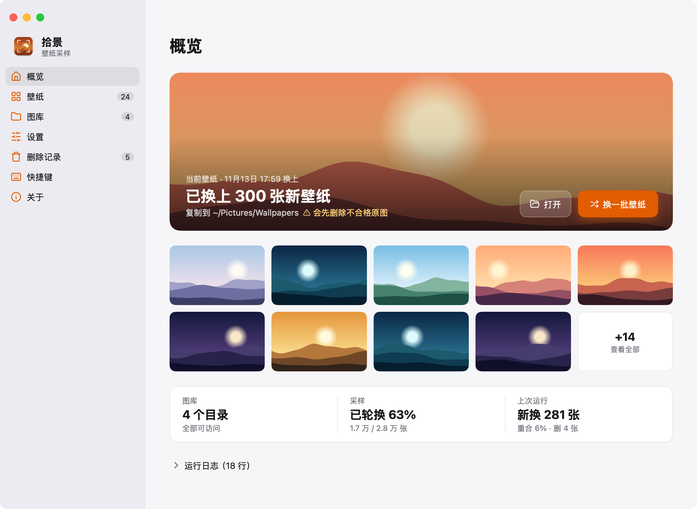
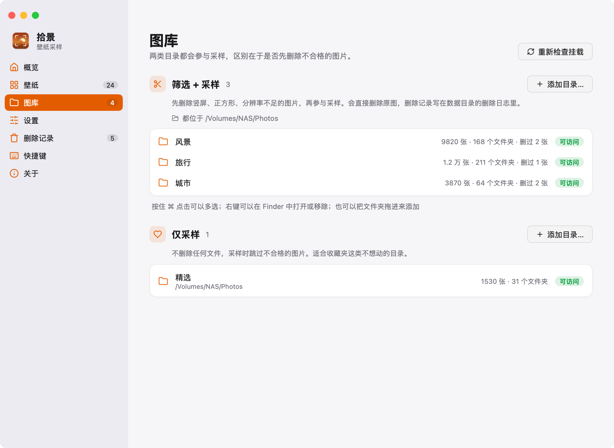
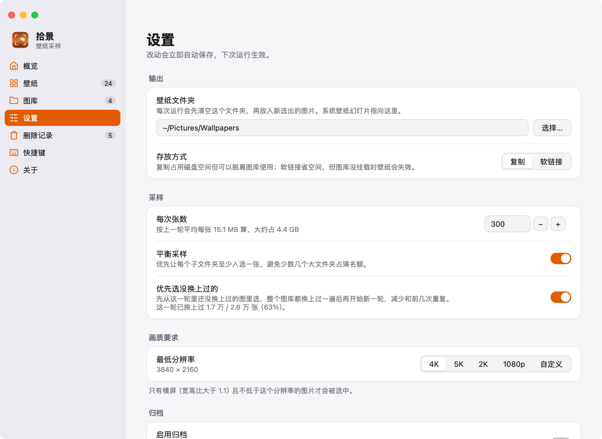
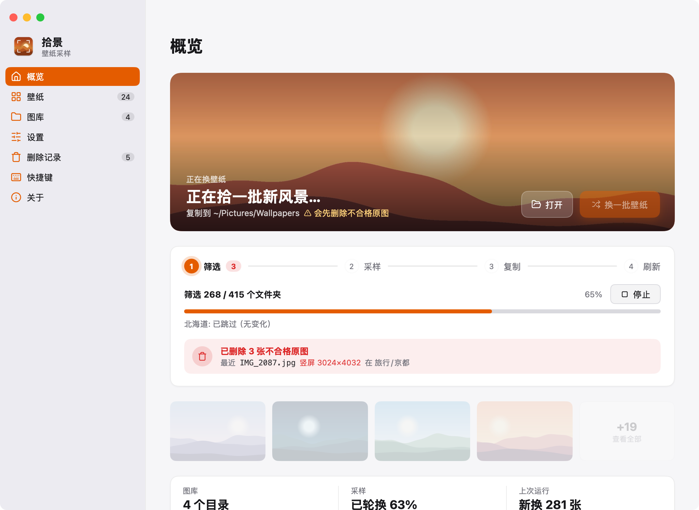
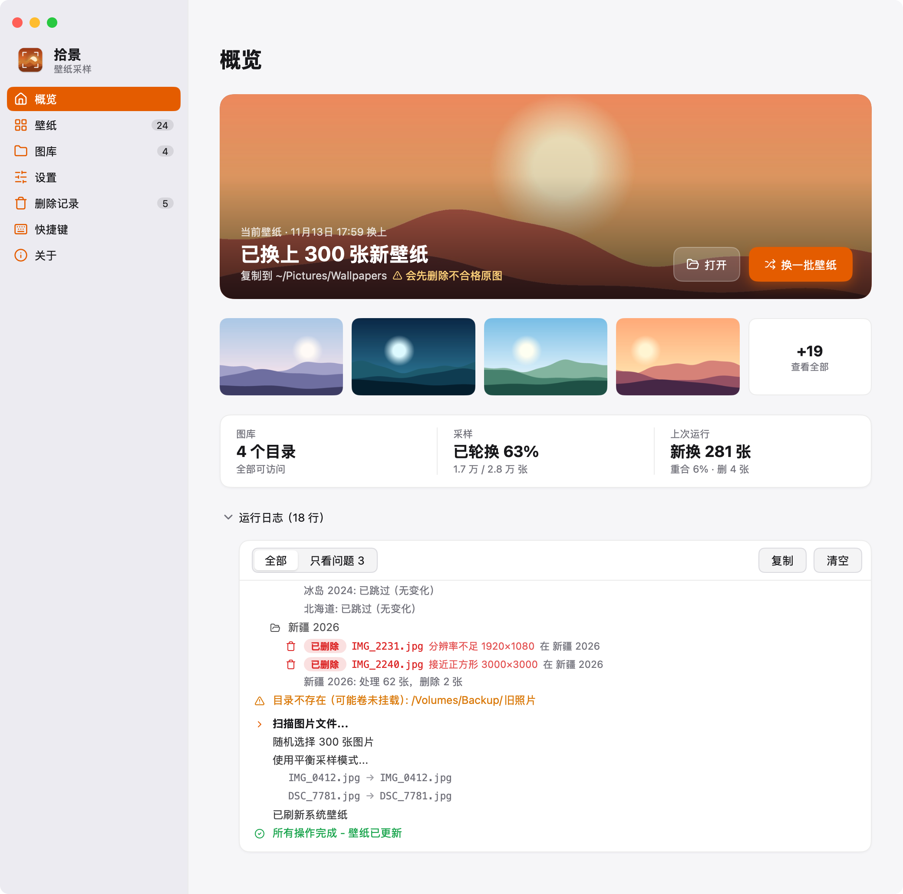
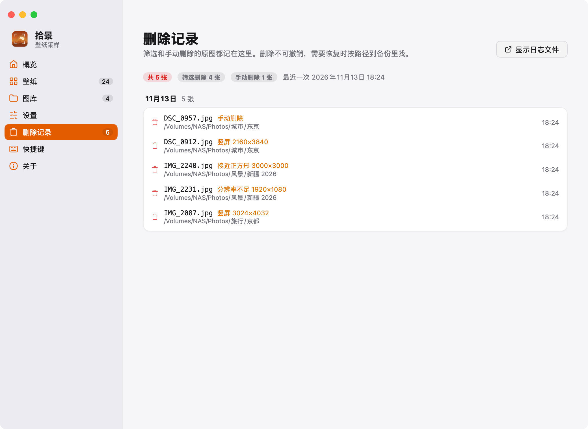
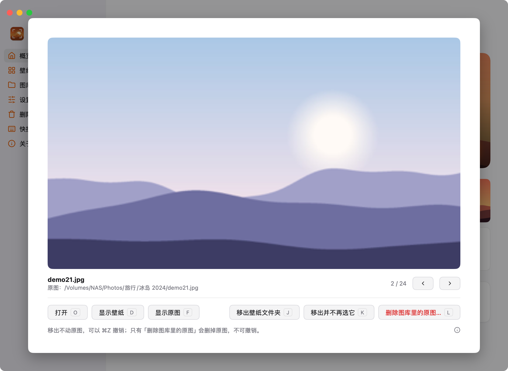
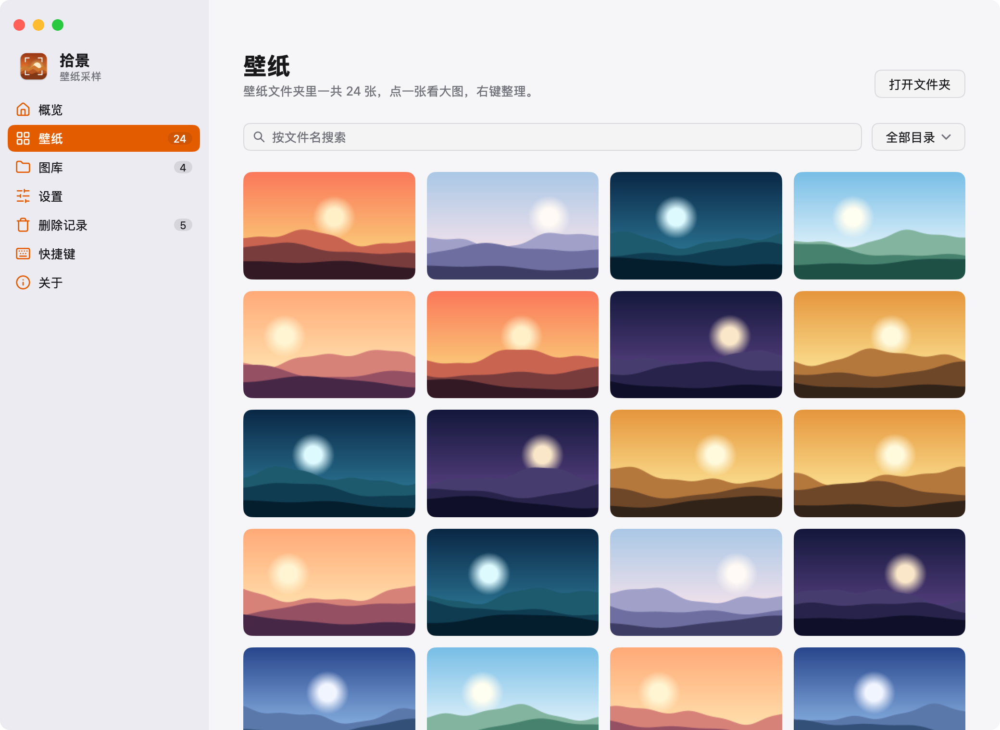
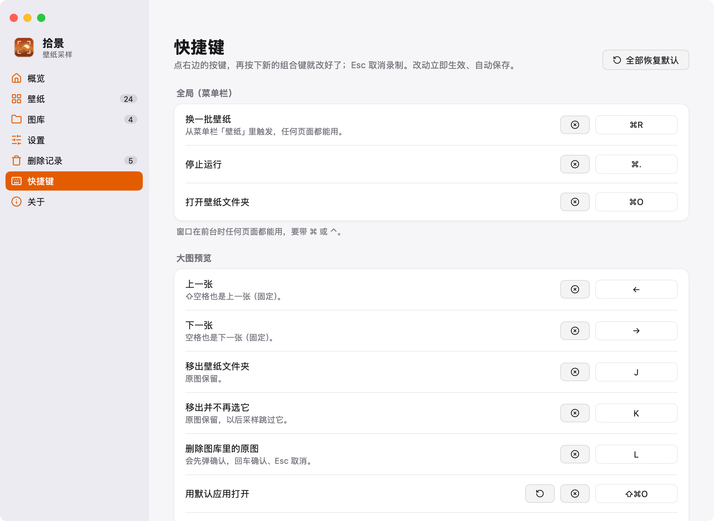

# 拾景

从 NAS 上的大型图片库里，按分辨率和方向挑出合格的横屏图片，随机拾一批放进壁纸文件夹，配合 macOS「系统设置 › 墙纸」的文件夹随机切换使用。

原生 macOS 应用，Go + [MyGo](https://mygo.egoist.dev/) 写成（原生 UI，不走 webview），跟随系统浅色 / 深色。

<picture>
  <source media="(prefers-color-scheme: dark)" srcset="docs/screenshots/overview-dark.png">
  
</picture>

## 安装

在 [Releases](../../releases) 下载最新版，拖进「应用程序」。两个安装包任选其一：`shi-jing-<版本>.dmg` 是通用版，Intel 和 Apple Silicon 都能用；`shi-jing-<版本>-arm64.dmg` 只支持 Apple Silicon，体积约一半。

应用没有经过苹果公证，第一次打开时右键点应用选「打开」，或在「系统设置 › 隐私与安全性」里允许。

然后在「系统设置 › 墙纸」里把壁纸设为拾景的壁纸文件夹（默认 `~/Pictures/Wallpapers0`），打开随机切换。

## 用法

1. **图库**：添加图片所在的目录（通常在 NAS 上）。两类目录都会参与采样：
   - **筛选 + 采样**：先删掉竖屏、正方形、分辨率不够的原图，再参与采样
   - **仅采样**：不删任何文件，采样时跳过不合格的图片，适合收藏夹这类不想动的目录
2. **设置**：选壁纸文件夹、每次张数、最低分辨率（4K / 5K / 2K / 1080p / 自定义）。改动自动保存。
3. **概览**：点「换一批壁纸」（⌘R）。依次 筛选 → 采样 → 复制 → 刷新系统壁纸，系统的文件夹轮换会立刻用上新的一批。缩略图按窗口大小铺满，顺序在下次换一批之前固定不变；点一张看大图（窗口越大预览越大，全屏也行），←→ 或鼠标滚轮可以翻看这一批的全部壁纸；预览里和右键菜单都可以「移出壁纸文件夹」「移出并不再选它」（这两个都不动原图），或「删除图库里的原图」（不可撤销；NAS 没连上时会排进队列，连上后自动执行）。预览可以全程用键盘，手不用离开主键区：空格 / ⇧空格（或 ←→）切换，J 移出，K 移出并不再选，L 删除原图（回车确认），⌘Z 撤销刚才的移出（J、K 和右键菜单的移出都能撤销，删除原图不能），直接输入编号再按回车跳到那一张，O 用默认应用打开，D / F 在 Finder 中选中这张壁纸 / 它的原图，Esc 关闭；按钮上都标着快捷键（可以在「快捷键」页改）。
4. **壁纸**：缩略图最后一格「+N」打开这一页，看壁纸文件夹里的全部图片，可以按文件名搜索、按原图目录筛选（和手机上的「全部壁纸」一样）；点一张看大图，右键是同一组整理操作。

<table>
  <tr>
    <td></td>
    <td></td>
  </tr>
  <tr>
    <td align="center">图库：两类源目录和挂载状态</td>
    <td align="center">设置：自动保存，没有保存按钮</td>
  </tr>
  <tr>
    <td></td>
    <td></td>
  </tr>
  <tr>
    <td align="center">运行中：步骤、进度、删除情况，随时可以停止</td>
    <td align="center">运行日志：按类型排版，可只看问题</td>
  </tr>
  <tr>
    <td></td>
    <td></td>
  </tr>
  <tr>
    <td align="center">删除记录：删了哪张、在哪、为什么</td>
    <td align="center">大图预览：全程键盘操作，按钮上标着快捷键</td>
  </tr>
  <tr>
    <td></td>
    <td></td>
  </tr>
  <tr>
    <td align="center">壁纸：按文件名搜索、按原图目录筛选</td>
    <td align="center">快捷键：点一下再按新的组合就改好了</td>
  </tr>
</table>

> [!WARNING]
> 「筛选 + 采样」目录里不合格的图片会被**直接删除**（NAS 上的原图，不可撤销）。第一次用或调了分辨率时，建议先在设置里关掉「删除不合格原图」模拟跑一遍，看日志里的「待删除」是否符合预期。开着删除时，点「换一批壁纸」会先弹窗确认；每个被删的文件都记在「删除记录」页里（含原因）。

## 功能

- **增量筛选**：只检查有变化的文件夹；判断变化时忽略 `._*`、`.DS_Store`、`@eaDir` 等 macOS / NAS 产生的文件；分辨率改了自动全部重查
- **平衡采样**：每个子文件夹优先入选一张，每次覆盖到的文件夹都不一样
- **优先选没换上过的**：记下这一轮轮换里换上过的图，下次先从没换上过的里选，整个图库轮完一遍再重新开始；概览页显示「已轮换 63%」和这次比上一轮新换了几张、重合率多少
- **看得见删了什么**：运行中实时显示删了几张、最近删的是哪张；「删除记录」页按日期列出每张被删原图的路径和原因（竖屏 / 接近正方形 / 分辨率不足 / 手动删除）
- **图库统计**：每个目录显示可用图片数、文件夹数、删过几张；设置页按上一轮的平均大小预估每批占多少空间；复制时显示剩余时间
- **在缩略图上整理**：移除不喜欢的、加入「不再选」名单（图库页可以恢复），或直接删除原图（会确认，记进删除记录）
- **图库不在也能整理**：NAS 没连上时看图、移出、撤销、不再选都照常；点「删除原图」会排进队列（壁纸文件夹里那份先移出，⌘Z 可撤销），概览页显示「N 项原图等着删除」、可以逐条取消；图库连上后自动校验文件没变、再删除并记进删除记录
- **自动换壁纸**（可选）：每 6 / 12 小时、每天或每周自动换一批。自动运行不删除原图，只模拟筛选
- **为 NAS 优化**：读目录、读图片尺寸、复制都并发进行；没有改动时整轮筛选只要十几秒
- **安全**：先确认选出了图片才清空壁纸文件夹（NAS 没挂载时不会白白清空）；目录没挂载会提示，全部没挂载时不能运行
- **刷新系统壁纸**：换完后重启 macOS 的壁纸服务（`WallpaperAgent`）。系统的文件夹轮换只在启动时读一次文件夹，不刷新的话会停在已经删掉的旧图上
- **拖放添加**：把文件夹拖到图库页对应的区域就能添加
- **后台运行**：关掉窗口不退出，任务继续跑；Dock 图标上有运行状态角标，窗口隐藏时跑完会发通知。⌘Q 才真正退出
- **手机遥控**（可选，iOS）：在设置里打开「允许手机遥控」，同一局域网里的 iPhone 用拾景 App 配对后可以看实时进度、换一批壁纸、停止运行，浏览当前壁纸的缩略图和大图，并移出 / 不再选 / 删除原图 / 撤销移出 / 分享原图，改常用设置、看日志和删除记录；还有主屏幕小组件和快捷指令；会删原图时手机上先确认，也可以选这次只模拟。见下文
- **硬链接归档**（可选）：在 NAS 上额外留一份这批图片的硬链接副本，见下文
- **复制或软链接**：软链接省空间，但 NAS 没挂载时壁纸会显示不出来

快捷键：⌘R 换一批壁纸、⌘. 停止、⌘O 打开壁纸文件夹、⌘1–5 切换页面、⌘, 设置。换一批 / 停止 / 打开壁纸文件夹和预览里的全部操作都可以在侧边栏的「快捷键」页改：点一下再按新的组合，冲突时会提示，改动保存在配置的 `shortcuts` 里。

## 手机遥控（iOS）

iOS 端是原生 SwiftUI 应用，只是遥控器：筛选和复制都在 Mac 上跑。窄屏一栏；宽屏（横屏、iPhone Duo 展开的内屏、iPad）顶部一张状态卡、下面左右两栏，按实际宽度自动切换。

- 概览：顶部横幅卡用当前壁纸里的一张当背景（和电脑上概览顶部同一张，点图看大图），上面压一块毛玻璃放当前状态、换一批 / 停止、运行步骤和进度；下面是「上一轮对比」（新换上多少、重合率、筛选删除、覆盖了多少文件夹）和电脑上的常用设置（可以直接改）。右上角的连接状态只在断开、重连、配对失效时才出现。设置分组底部（「关于」里）能看到手机上拾景的版本号。
- 当前壁纸：缩略图网格，点开大图预览——左右滑翻页（首尾相接），双指缩放，双击在「铺满 / 完整显示」之间切换（横屏默认铺满，竖屏默认完整）。上下滑分两级：上滑一次拉出底部的操作列表（顶栏和缩略图条都在），列表再上滑进入全屏（都藏起来只剩图）；全屏或列表下滑回到常态，常态再下滑才关闭预览。底部缩略图条可以拖着快速找图，点顶部编号输入数字跳转；操作按钮按宽度自适应，窄的时候变成图标在上、小字在下的四列工具栏，不占太多高度。点一下图片可以藏起顶栏和底栏，再点一下回来；操作列表开着的话会一起回来，关掉预览时也会记住，下次打开还是上次的样子。
- 整理：预览底栏或长按缩略图可以「移出」（只删壁纸文件夹里那份，电脑上能 ⌘Z 撤销）、「不再选它」、「删除图库里的原图」（二次确认，不可撤销，记进删除记录）。正在换壁纸时不能整理。
- 撤销移出：概览「当前壁纸」里和预览顶栏的 ↶（和电脑上 ⌘Z 是同一个撤销栈）。
- 存原图 / 分享原图：预览底栏和长按菜单里的「存到相册」从电脑下载原文件、原样存进相册（不重新压缩，保留 EXIF）；预览顶栏的分享按钮下载后弹系统分享面板。
- **连不上电脑时也能看、能整理**：每次连上都会把当前壁纸列表、状态和缩略图存在手机上（换一批后自动换成新的）。连上时还会在后台把整批 2048 宽的预览图也缓存下来（默认上限 10 GB，可在设置 › 离线里改、暂停或清除），所以离线时每张都能看大图。Mac 睡眠、拾景没开、不在同一个网络时，App 打开显示上次同步的内容，顶部标「离线 · X 前同步」；离线时点「移出」「不再选」会先记下来，连上电脑后自动补上（「不再选」按原图路径补，即使这一批已经换掉也有效）；记下的操作在设置 ›「待补操作」里看得到、能逐条取消或全部取消，离线时也能直接撤销刚才的「移出」（那张会放回列表原来的位置）；「删除原图」不可撤销，离线时按钮是灰的，要等连上再做；「存到相册」和「分享原图」要连上电脑下载原文件，离线时同样是灰的。图片缓存占多少在「设置 › 离线」里能看到，也可以一键清除。运行日志、删除记录、「不再选」名单在连上和每换完一批时也会各存一份，离线时打开只显示这一份并标明是什么时候同步的（离线时只能查看，「不再选」要等连上才能恢复）；设置页离线时会说明「现在连不上电脑，设置只能查看」。
- 界面分三个标签：概览、设置、记录（和电脑上的侧边栏对应）。
- 改设置（「设置」标签，分组和电脑上一样）：每次张数、自动换的间隔、优先选没换上过的、换完刷新系统壁纸、删除不合格原图，改完电脑上同步生效（和在电脑上改一样自动保存）。
- 记录：运行日志（运行中自动刷新）、删除记录（按天分组）、「不再选」的图片（左滑恢复一张或全部恢复）。
- 小组件两种，尺寸全支持（小 / 中 / 大 / 超大，iPad 超大和 iOS 27 的 iPhone 整页，「拾景」还有锁定屏幕的三种）：
  - 「拾景」：背景是当前壁纸里的一张，上面是状态和「换一批」/「停止」按钮；从小组件换一批不删原图。
  - 「拾景壁纸」：只显示壁纸，可选在角落显示文件名。
  - 长按小组件 →「编辑小组件」可以改换图间隔（5 分钟到 1 天）。点小组件直接打开那张的大图。
  - 不在家（连不上 Mac）时用上次缓存的状态和图接着轮换，并标「离线」，回到局域网自动恢复。
- 控制中心 / 锁定屏幕的「换一批壁纸」按钮（iOS 18+）。
- 快捷指令 / Siri / 操作按钮：「换一批壁纸」「停止换壁纸」「壁纸状态」，不用打开 App，比如对 Siri 说「用拾景换一批壁纸」。
- 换完发通知：App 在后台还连着、或小组件刷新时看到这次换完，就发一条本地通知（没有推送，所以不保证每次都有）。
- 签名到期提醒：免费签名 7 天过期，剩不到 2 天时概览顶部提醒，前一天发通知；设置分组底部写着到期时间。
- 配对过多台 Mac 时，点顶部的 Mac 名字切换；添加、移除也在这个菜单里。小组件和快捷指令连的是 App 里选中的那台。

1. Mac 上打开拾景的「设置 › 手机遥控 › 允许手机遥控」。拾景会监听端口 52819（被占用时换一个），并用 Bonjour 广播自己。
2. iPhone 上打开拾景 App，第一次会问是否允许访问本地网络，选允许。首页会列出这台 Mac，点它、请求配对，Mac 上会弹出 6 位配对码，在手机上输入。
3. 之后打开 App 就能看到这台 Mac 的状态。在 Mac 的设置页可以看到配对过的手机、是否在线，随时取消配对。

要求 Mac 醒着、拾景开着（关掉窗口也行，它会在后台运行）。Mac 睡眠时手机连不上，可以在「系统设置 › 电池 / 能源」里打开「唤醒以供网络访问」。

局域网里走明文 HTTP，靠配对令牌保护（Mac 上只存令牌的 SHA-256）。没有上架，需要自己用 Xcode 装到手机上，步骤见 [`ios/README.md`](ios/README.md)。

## 硬链接归档

开启后，每张选中的图片除了复制到壁纸文件夹，还会在归档目录（默认 `{源目录的上级}/_WallpaperArchive/`）留一份链接：优先硬链接（不占额外空间），不支持时退回相对路径软链接。归档目录每次只保留这一批。

macOS 的 SMB 客户端不支持硬链接，它在 SMB 上建的软链接 Windows 又读不了。如果 NAS 对同一份数据还开了 NFS，在「设置」的「归档」分组里打开归档，再填上 SMB 挂载根（如 `/Volumes/Media0`）和 NFS 挂载根（如 `/Volumes/nfs/Media0`）：扫描、采样、复制仍然走 SMB，只有建归档链接这一步换到 NFS 下做硬链接，Windows 那边看到的也是普通文件。

## 数据文件

都在 `~/Library/Application Support/拾景/`，设置页和关于页都可以直接在 Finder 中打开：

| 文件 | 内容 |
|---|---|
| `config.json` | 配置（设置页可以「导入配置…」） |
| `image_sorter_state.json` | 增量筛选状态。想强制全部重新筛选：退出应用后删掉它 |
| `image_sorter_deleted.log` | 删除日志：每行是时间、阈值、被删文件的完整路径、原因。「删除记录」页就是读的它 |
| `ui_state.json` | 上次运行的结果、是否跳过删除确认 |
| `last_selection.json` | 上一轮选中了哪些原图和对应的壁纸文件名，用来算重合率、在缩略图上找到原图 |
| `selection_history.json` | 这一轮轮换里换上过的原图（「优先选没换上过的」）。想从头开始轮换：删掉它 |
| `remote_devices.json` | 配对过的手机（名字、配对时间、令牌的 SHA-256）。删掉它等于取消所有手机的配对 |
| `pending_deletes.json` | 图库没连上时排队的「删除原图」，连上后自动执行。删掉它等于取消全部排队（壁纸文件夹里已经移出的那张要用 ⌘Z 恢复） |

<details>
<summary>config.json 字段</summary>

| 字段 | 说明 | 默认值 |
|------|------|--------|
| `filter_and_sample_dirs` | 「筛选 + 采样」目录 | `[]` |
| `sample_only_dirs` | 「仅采样」目录 | `[]` |
| `dest_dir` | 壁纸文件夹（每次运行会先清空） | `~/Pictures/Wallpapers0` |
| `sample_count` | 每次张数 | `300` |
| `min_width` / `min_height` | 最低分辨率 | `3840` / `2160` |
| `mode` | `copy`（复制）或 `symlink`（软链接） | `copy` |
| `balance_first` | 平衡采样 | `true` |
| `incremental` | 增量筛选 | `true` |
| `delete_during_filter` | 筛选时实际删除（`false` 为模拟运行） | `true` |
| `clear_wallpaper_cache` | 换完后刷新系统壁纸（键名沿用旧的「清除壁纸缓存」） | `true` |
| `archive_enabled` | 硬链接归档 | `false` |
| `archive_subdir_name` | 归档子文件夹名 | `_WallpaperArchive` |
| `archive_dir_override` | 归档父路径（留空用各源目录的上级） | `""` |
| `archive_smb_root` / `archive_nfs_root` | SMB → NFS 换算的两个挂载根 | `""` |
| `prefer_unseen` | 优先选这一轮还没换上过的图 | `true` |
| `excluded` | 不再参与采样的原图 | `[]` |
| `auto_run_hours` | 自动换壁纸的间隔（小时，`0` 关闭）；自动运行不删除原图 | `0` |
| `remote_enabled` | 允许配对过的 iPhone 遥控 | `false` |
| `shortcuts` | 改过的快捷键（操作 id → `Cmd+Shift+Backspace` 这种写法，空字符串为不用）；没写的用默认值，界面里改即可 | 无 |

</details>

## 开发

代码在 `desktop/`，需要 Go 1.27+（`brew install go`）。

```bash
cd desktop
go tool mygo dev                        # 开发：改代码自动重编译重启
go tool mygo build -skip-notarize       # 打包本机版：build/darwin-arm64/
go tool mygo build -skip-notarize -platform darwin/universal   # 打包通用版：build/darwin-universal/
CGO_ENABLED=0 go test ./...             # 测试（界面测试不需要窗口）
go tool mygo vet .                      # MyGo 的界面规则检查
SHOTS_DIR=$PWD/../docs/screenshots CGO_ENABLED=0 go test -run TestScreenshots .   # 重新生成 README 截图
```

| 路径 | 内容 |
|---|---|
| `core/` | 筛选 / 采样 / 归档 / 流程编排，带测试；通过 `core.Reporter` 上报日志、进度，接收停止请求 |
| `app.go` / `view.go` | 界面状态和后台任务 / 窗口骨架和侧边栏 |
| `overview.go` / `wallsview.go` | 概览页 / 壁纸页（搜索、按原图目录筛选） |
| `library.go` / `settings.go` | 图库页 / 设置页（含归档） |
| `thumbs.go` / `preview.go` / `undo.go` | 壁纸缩略图 / 大图预览和编号跳转 / 移出的撤销 |
| `thumbcache.go` / `decode_darwin.go` | 缩略图的磁盘缓存 / 用系统 ImageIO 解码图片 |
| `theme.go` / `icons.go` / `logview.go` | 配色和通用组件 / Lucide 图标 / 运行日志的解析和排版 |
| `thumbs.go` | 后台读取壁纸文件夹、生成横幅和缩略图 |
| `main.go` / `background.go` / `menu.go` | 窗口和系统对话框 / 关窗后台运行、Dock 角标、通知 / 菜单栏快捷键 |
| `about.go` / `uistate.go` | 关于页 / 上次运行结果（`ui_state.json`） |
| `remote.go` / `remoteview.go` | 手机遥控的局域网接口、配对、Bonjour 广播 / 设置页分组和配对码弹层 |
| `remotewalls.go` | 手机遥控的壁纸接口：列表（带横幅图）、缩略图 / 横幅 / 大图、移出 / 不再选 / 删除原图 |
| `remoteextra.go` | 手机遥控第 3 期：改常用设置、运行日志、删除记录、「不再选」名单和恢复、撤销移出、下载原图 |
| `pending.go` / `core/pending.go` | 图库没连上时排队的「删除原图」：队列的读写、校验后执行、概览里的提示和弹层 |
| `screenshots_test.go` | 用演示数据渲染 README 截图（不读真实图库） |
| `cmd/wallpaper/` | 命令行入口，用同一份配置跑完整流程（`go run ./cmd/wallpaper`） |

iOS 端在 `ios/`，构建方法见 [`ios/README.md`](ios/README.md)。

拾景最早是一组 Python 脚本，现在只维护这个原生应用。

作者：[@love1017best](https://github.com/love1017best)
